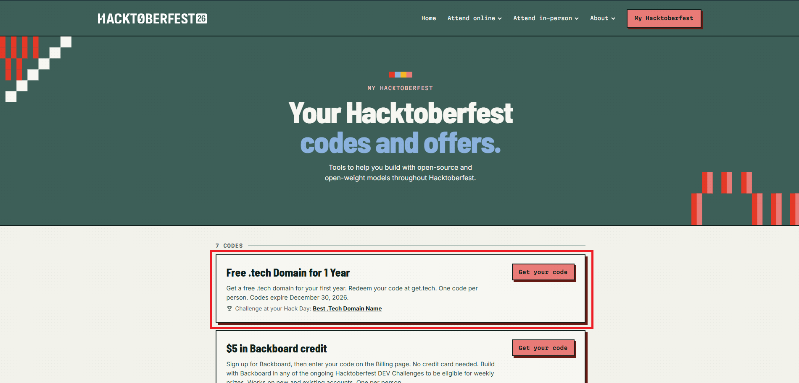
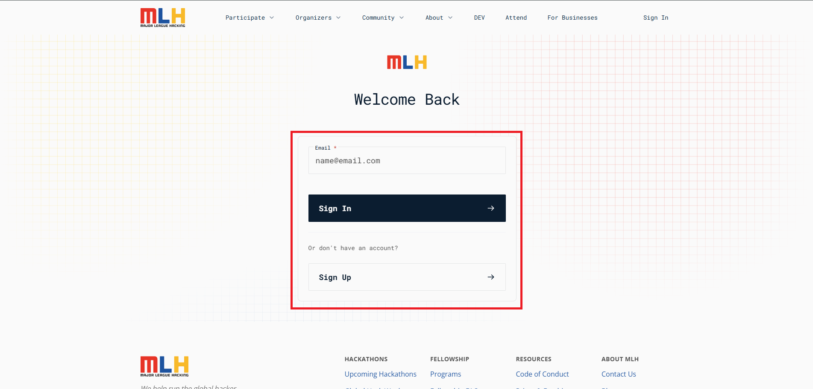
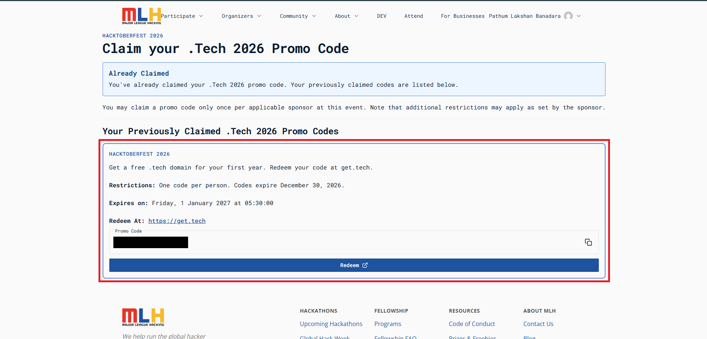
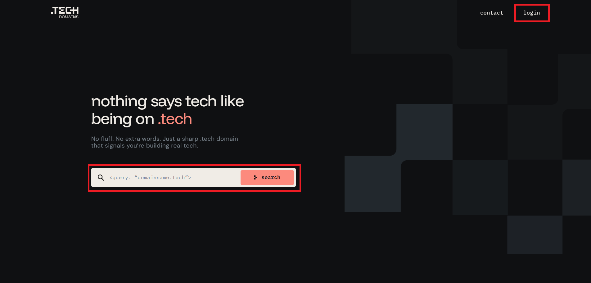
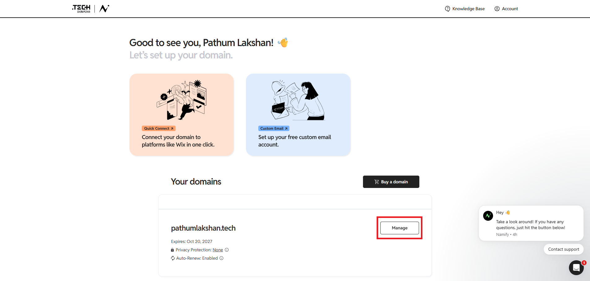
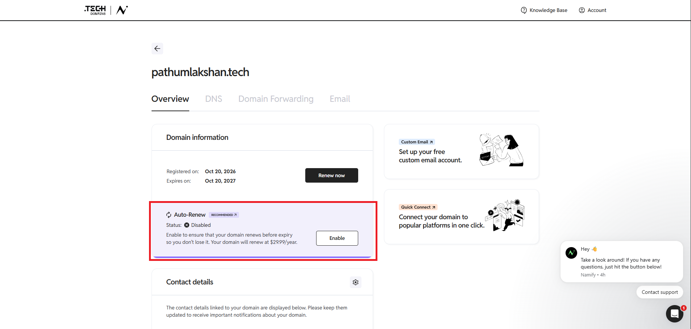

# How to Get a FREE .TECH Domain Through Hacktoberfest 2026

A step-by-step guide for developers, students, and open-source contributors who want to claim a promotional `.TECH` domain for their portfolio, personal website, or software projects.

> **Important:** This offer is subject to eligibility requirements, promotional code availability, and the official terms. Confirm that the offer is still active and check the final checkout price before placing an order.

## Table of Contents

- [Introduction](#introduction)
- [Repository Structure](#repository-structure)
- [What Is the .TECH Domain Offer?](#what-is-the-tech-domain-offer)
- [Why Get a Custom Domain?](#why-get-a-custom-domain)
- [Prerequisites](#prerequisites)
- [Step 1: Open the Hacktoberfest Promotions Page](#step-1-open-the-hacktoberfest-promotions-page)
- [Step 2: Verify Your Account](#step-2-verify-your-account)
- [Step 3: Claim Your Promotional Code](#step-3-claim-your-promotional-code)
- [Step 4: Choose Your Domain](#step-4-choose-your-domain)
- [Step 5: Apply the Promotional Code](#step-5-apply-the-promotional-code)
- [Step 6: Complete Domain Registration](#step-6-complete-domain-registration)
- [Step 7: Disable Auto-Renewal if Needed](#step-7-disable-auto-renewal-if-needed)
- [Step 8: Connect Your Domain to Your Website](#step-8-connect-your-domain-to-your-website)
- [Troubleshooting](#troubleshooting)
- [Security and Safety Tips](#security-and-safety-tips)
- [Frequently Asked Questions](#frequently-asked-questions)
- [Conclusion](#conclusion)
- [Official Resources](#official-resources)

## Introduction

Are you looking for a custom domain for your developer portfolio without paying the initial registration fee?

Hacktoberfest 2026 participants may be able to access a promotional offer for a `.TECH` domain through the relevant developer promotion.

A custom domain can help you establish your online identity, showcase your projects, publish technical articles, and create a professional website.

This guide explains the process described in the referenced tutorial, from checking your eligibility to registering the domain and managing renewal settings.

## What Is the .TECH Domain Offer?

The promotion described in the tutorial offers an opportunity to register a `.TECH` domain for one year at no cost, provided that you meet the applicable requirements and successfully redeem a valid promotional code.

A `.TECH` domain is a domain extension commonly suited to technology-related websites, including:

- Developer portfolios
- Software engineering projects
- Technical blogs
- AI and machine learning projects
- Technology communities
- Startup and product websites

The tutorial demonstrates obtaining a promotional code through the Hacktoberfest promotions page and applying it during domain registration.

**Please note:** Promotional availability, eligibility, and redemption requirements can change. The offer is not guaranteed for every account.

## Why Get a Custom Domain?

A personal domain can be useful for building your online presence.

| Use case | Example |
|---|---|
| Developer portfolio | `yourname.tech` |
| Technical blog | `yourblog.tech` |
| AI/ML project | `yourproject.tech` |
| Startup landing page | `yourstartup.tech` |
| Personal project hub | `yourhub.tech` |

These are illustrative examples only; availability must be checked with the registrar.

With a custom domain, you can connect your website to a supported hosting platform and share one memorable address with recruiters, collaborators, and the developer community.

## Prerequisites

Before starting, prepare the following:

- A MyMLH or Hacktoberfest account, as required by the offer.
- A GitHub account for the account-connection process.
- Access to your email account for verification.
- A mobile number if phone verification is required.
- A preferred domain name.
- A payment method if the registrar requires one, even for a discounted order.

### Account age requirements

The referenced tutorial reports these account-age requirements:

| Account | Age stated in the tutorial |
|---|---|
| GitHub | At least 30 days old |
| MyMLH | At least 7 days old |

These requirements are based on the tutorial and should not be treated as independently verified, current official terms. Check the promotion page for the rules that apply to your account.

## Step 1: Open the Hacktoberfest Promotions Page

Visit the official promotions page:

**https://hacktoberfest.com/my/promos**

1. Sign in to your account.
2. Locate the `.TECH` domain promotion.
3. Read the offer description.
4. Check the eligibility requirements and availability.

If the promotion is available to your account, continue to the verification process.

If you cannot find the offer, it may not be available to your account or its promotional allocation may have been exhausted.

## Step 2: Verify Your Account

Follow the verification process shown on the official website.

Depending on the current requirements, you may need to:

1. Verify your email address.
2. Add and verify your mobile number.
3. Connect your GitHub account.
4. Authorize the requested GitHub connection.
5. Return to the promotion page and refresh it.

Only authorize connections on official websites and review the permissions requested before approving access.

Once the verification process is complete, check whether the promotion has become available.

## Step 3: Claim Your Promotional Code

On the promotions page, open the `.TECH` offer and select the option to obtain your code.

If your account is eligible and codes remain available, a promotional code may be displayed.

1. Copy the code.
2. Keep it private.
3. Continue to the domain registration process.

### What if no code is available?

You might see a message such as:

`We don't have any codes for you yet.`

Possible reasons include:

- Your account does not meet the applicable eligibility requirements.
- A required account connection or verification step is incomplete.
- The promotional allocation is exhausted.
- The offer is temporarily unavailable.

Review the official requirements and try again if appropriate. Do not attempt to bypass eligibility checks.

## Step 4: Choose Your Domain

Visit the domain registration website linked from the official promotion.

Search for the domain name you want to register.

For example, you could choose a name based on your personal brand, portfolio, technical blog, or project.

1. Enter your preferred domain name.
2. Check its availability.
3. Select the `.TECH` extension.
4. Add the domain to your cart.
5. Continue to checkout.

Before proceeding, confirm that you have selected the correct extension and that the registration period matches the promotion.

## Step 5: Apply the Promotional Code

At checkout, look for the promotional-code or coupon field.

1. Paste your code into the field.
2. Apply the code.
3. Wait for the order summary to update.
4. Confirm that the eligible one-year domain registration charge has been discounted as promised.
5. Review taxes, optional services, and other fees.

### Review domain privacy settings

The referenced tutorial demonstrates turning off domain privacy protection during checkout.

However, whether this is necessary depends on the offer's current terms and the registrar's rules.

Domain privacy services may help protect personal registration details from public exposure, depending on the registry and registrar policies.

Do not disable privacy protection automatically. Check the official offer instructions and understand the privacy implications before changing the setting.

**Before placing your order, confirm the final amount payable.** Do not assume that every item in the checkout is free simply because the promotional domain price is zero.

## Step 6: Complete Domain Registration

The registrar may ask you to sign in or create an account before completing your order.

Follow the official registration process and provide the information required by the registrar.

If a payment method is requested:

1. Review the final order total.
2. Check for taxes and optional add-ons.
3. Review any recurring charges.
4. Read the renewal terms.
5. Proceed only when you understand the charges that may apply.

A zero-price domain registration does not necessarily mean that no payment method will be required.

After completing the order, check your email and registrar dashboard for confirmation.

Verify the following:

- The domain appears in your account.
- The registration was successful.
- The expiration date is correct.
- The order receipt reflects the expected discount.
- You understand the renewal price and terms.

## Step 7: Disable Auto-Renewal if Needed

This is an important step if you want to avoid an unexpected renewal charge.

The first year may be free while subsequent renewals are charged at the registrar's normal price.

If you do not want the domain to renew automatically:

1. Sign in to your domain registrar.
2. Open your domain management dashboard.
3. Select your registered domain.
4. Locate the auto-renewal setting.
5. Disable auto-renewal if appropriate.
6. Save the change.
7. Return to the settings and verify that the updated status is displayed.

The exact interface depends on the registrar.

### What happens after disabling auto-renewal?

Your domain should not automatically renew under the registrar's applicable policy, but you will need to renew it manually if you want to continue using it.

Keep track of the expiration date. If the domain expires, your website and other services using it may stop working.

Disabling domain renewal also does not necessarily cancel separate paid products or subscriptions. Review those independently.

## Step 8: Connect Your Domain to Your Website

After registering your domain, you can connect it to a supported website hosting provider.

Common options include:

- [Vercel](https://vercel.com/)
- [Netlify](https://www.netlify.com/)
- [GitHub Pages](https://pages.github.com/)

The general process is similar across hosting platforms.

### 1. Add your custom domain

Open your hosting provider's dashboard and find the custom domain settings for your website.

Enter the domain you registered.

### 2. Configure DNS

The hosting provider will tell you which DNS records or nameservers to configure.

Depending on your setup, these may include:

- `A` records
- `CNAME` records
- `AAAA` records
- Nameserver settings

Use the exact values provided by your hosting platform. Do not copy DNS values from an unrelated tutorial.

### 3. Update DNS settings

Open the registrar's DNS management panel and add or update the required records.

Avoid deleting existing records unless you understand their purpose, especially if the domain is already used for email or other services.

### 4. Wait for DNS propagation

DNS changes can take time to become visible across different networks.

Follow your hosting provider's instructions while waiting for verification.

### 5. Verify your website

Once the domain has been connected, confirm that:

- The domain resolves to the intended website.
- The hosting provider reports successful domain verification.
- HTTPS is configured correctly.
- The website loads using the custom domain.

You can now share your website using your own domain name.

## Troubleshooting

### Problem 1: The promotion is not visible

**Possible solution:** Confirm that you are signed in to the correct account and review the offer's current eligibility requirements and availability.

### Problem 2: My GitHub or MyMLH account is too new

**Possible solution:** Check the official requirements. If the promotion requires an account to have existed for a minimum period, you may need to wait until your account meets that requirement.

### Problem 3: The promotional code does not work

**Possible solution:**

- Confirm that the code was copied correctly.
- Check that you selected the eligible domain extension.
- Review the code's expiration date and applicable terms.
- Contact the registrar's official support team if necessary.

### Problem 4: The checkout requests a payment card

**Possible solution:** Review the final order total and renewal terms. If the offer requires a payment method, decide whether you are comfortable providing it before continuing.

Never assume that a promotional order is risk-free simply because the displayed registration price is zero.

### Problem 5: I cannot find the auto-renewal setting

**Possible solution:** Open the registrar's official domain management documentation or contact its support team. The setting may be located under domain settings, billing, or renewal preferences.

### Problem 6: My website does not load after changing DNS

**Possible solution:**

- Verify that the records match your hosting provider's instructions.
- Check that you entered the correct domain.
- Allow time for DNS changes to propagate.
- Confirm that domain verification and HTTPS setup have completed.
- Review whether existing DNS records were accidentally changed.

## Security and Safety Tips

Follow these precautions when claiming a promotional domain.

- Use the official Hacktoberfest and registrar websites.
- Review the permissions requested when connecting GitHub.
- Never share your email verification code or account password.
- Do not publish private promotional codes.
- Check the final checkout total before confirming the order.
- Review the renewal price before providing payment information.
- Keep a record of your domain's expiration date.
- Avoid disabling privacy services unless the offer genuinely requires it and you understand the consequences.
- Do not share screenshots containing personal details, payment information, or verification codes.

## Frequently Asked Questions

### Is the .TECH domain completely free?

The referenced tutorial demonstrates a one-year promotional registration at no cost after applying a code. Actual eligibility, availability, taxes, and additional charges must be confirmed at checkout.

### Can anyone claim the offer?

Not necessarily. The promotion may have account eligibility requirements and a limited allocation of codes.

### Do I need a GitHub account?

The referenced tutorial uses GitHub account verification. Check the current official promotion instructions to confirm the requirements.

### Can I use the domain for my portfolio?

Yes, provided your intended website complies with the registrar's terms. You can connect the domain to a supported hosting platform using its DNS instructions.

### Can I use the domain with GitHub Pages?

GitHub Pages supports custom domains. Follow the official documentation to configure the required DNS records and verify your domain.

Documentation: https://docs.github.com/en/pages/configuring-a-custom-domain-for-your-github-pages-site

### Will I be charged after one year?

A renewal charge may apply if you renew the domain. Review the registrar's current pricing and auto-renewal settings.

### What if the offer is no longer available?

Check the official promotions page for updated information. Do not rely on an old tutorial to establish that promotional codes are still available.

## Conclusion

A custom domain can be a useful investment in your developer identity, especially if you want to showcase projects, publish technical content, or build a portfolio.

The Hacktoberfest `.TECH` promotion described in the tutorial may provide an opportunity to register a domain for one year without paying the standard registration price.

The key steps are to:

1. Check the official promotion.
2. Verify your account and eligibility.
3. Claim a promotional code if available.
4. Apply it and review the checkout total.
5. Complete registration.
6. Review auto-renewal and domain privacy settings.
7. Connect your domain to your website.

**Start by checking the official promotions page and carefully reviewing the current terms before placing your order.**

## Official Resources

- [Hacktoberfest Promotions](https://hacktoberfest.com/my/promos)
- [.TECH / MLH Promotion](https://get.tech/mlh)
- [Hacktoberfest FAQ](https://hacktoberfest.com/questions)
- [GitHub Pages Custom Domain Documentation](https://docs.github.com/en/pages/configuring-a-custom-domain-for-your-github-pages-site)
- [Vercel Documentation](https://vercel.com/docs)
- [Netlify Documentation](https://docs.netlify.com/)

---

**Disclaimer:** This repository is an independent community guide. It is not an official Hacktoberfest, MLH, or .TECH publication. The instructions are based on the referenced tutorial and may differ from the current process. Verify eligibility, availability, pricing, privacy requirements, and renewal conditions using the official sources.
